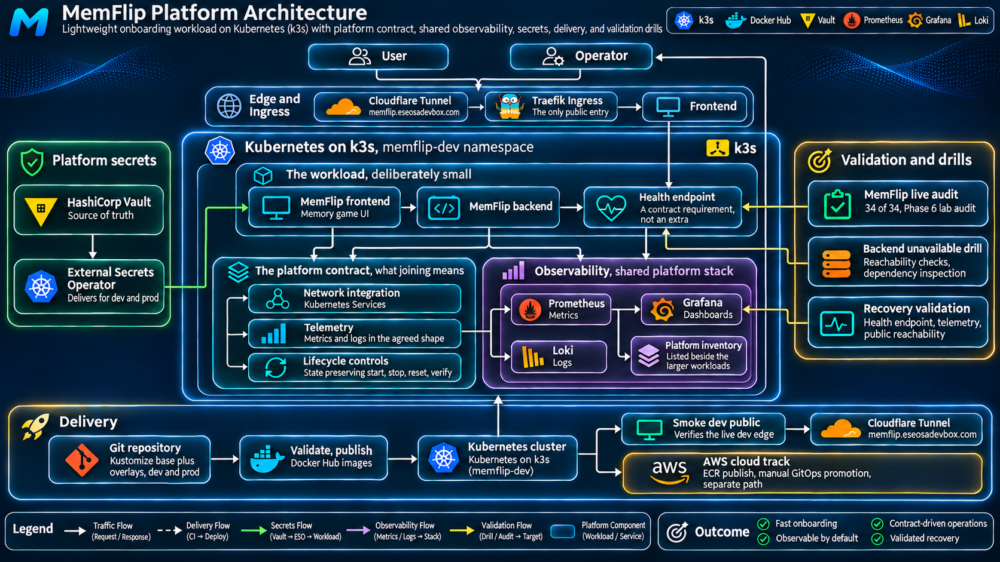
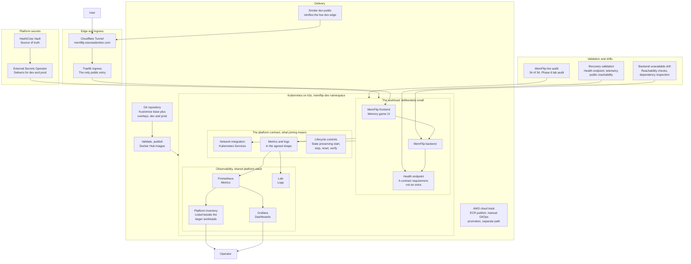
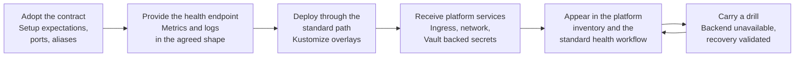

# MemFlip Platform Architecture

This document is the architecture design of record for the MemFlip onboarding workload. The image above is rendered from the Mermaid source in this file, so the picture and the source never drift apart.

## The design in one paragraph

MemFlip is the platform's reference onboarding workload, and its architecture is the contract it demonstrates. The workload is deliberately small (frontend, backend, health endpoint) so the platform behaviour around it stays legible: Traefik ingress as the only public entry, network integration through Kubernetes Services, metrics and logs in the agreed shape flowing to the shared Prometheus, Grafana, and Loki stack, presence in the platform inventory beside the larger workloads, and Vault backed secret delivery through External Secrets Operator for both dev and prod. The runtime is the memflip-dev namespace on the Phase 7 Kubernetes path (k3s, Kustomize base plus dev and prod overlays, Argo CD wiring, state preserving lifecycle controls). Delivery follows the workspace model: validate, publish Docker Hub images, and smoke verification of the public dev edge, with a separate AWS cloud track (ECR publish and manual GitOps promotion) that is not the local dev runtime. Validation is contract compliance: the MemFlip live audit passed 34 of 34 checks (Phase 6 lab audit), and the backend unavailable drill (reachability checks, dependency inspection, recovery validated against the health endpoint, telemetry, and public reachability) proves the smallest workload carries the full failure model.

## Architecture diagram, Mermaid source

## Flow diagram: onboarding a workload, Mermaid source

## Notes

- Lab environment. Audit counts are point in time lab validation results documented in the platform repository.
- The older manifest set in this repository is learning path archive material, not the current deployment standard.
- Live application: `https://memflip.eseosadevbox.com`.
